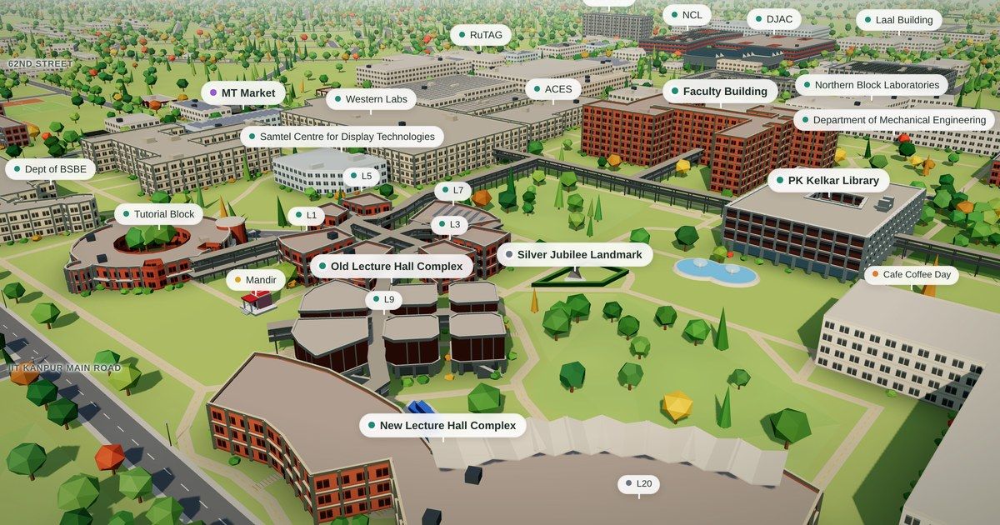

# IIT Kanpur in 3D

A hand-built 3D model of the IIT Kanpur campus that you can explore, search and find your way around, right in the browser.

**Live:** https://nisarg3176.github.io/iitk-3d-map/



Halls, lecture halls, the OAT, the main gate, cafés, shops and other landmarks are modelled from real photos and campus videos, with matching colours, signboards, entrances and even the street lamps at night.

## Features

- **Search anything**: halls and their blocks, departments, lecture halls, canteens, cafés, shops, roads and landmarks, by their real names or the short ones people use (CC, L20, CCD, MT, H12, ESB2…).
- **Find a professor's office**: type a professor's name to see their department, building and room on the map.
- **Directions from anywhere to anywhere**: pick a From and a To (or use your location) to get the walking route with distance and time.
- **Walk the route**: *Start* follows you live with GPS, turn by turn; *Preview* plays the walk so you can see it first.
- **Useful spots**: cycle repair, drinking water, toilets, ATMs and banks, photocopy, laundry, pharmacy, salons, post office, cycle parking, EV charging and lecture halls, each highlighted on the map with a list of the nearest ones.
- **Walk mode**: drop down to street level and stroll around campus.
- **Day and night**: the sun, shadows and seasons follow the real time in Kanpur; at night windows and street lamps light up.
- **2D map and angle lock**: switch to a flat map, or lock the tilt to zoom in easily; double-tap to zoom.
- **Filters and sharing**: show only academic, hostels, food, shops, sports, health or worship, and share a link to any place or route.
- **Works on any phone**: a lighter mode switches on by itself on slower phones.

### Tips

- Tap any building or label for details.
- `/` or `Ctrl K` jumps to search, `Tab` on a result starts directions there, `Esc` closes panels.
- Try searching **water**, **atm**, **photocopy**, **cycle repair** or a professor's name.

## Run it locally

It's a static site with no build step. Serve the folder with any web server, for example:

```bash
python3 -m http.server 8000
```

then open http://localhost:8000. Opening `index.html` directly from disk won't work, because the browser blocks loading the JSON files that way.

## Files

| File | What it is |
| --- | --- |
| `index.html` | The whole app: 3D scene, hand-made models, search, directions and UI (uses [three.js](https://threejs.org) from a CDN) |
| `campus.json` | Campus map data: buildings, roads, paths, places and details |
| `people.json` | Professors and their offices |
| `preview.jpg` | Preview image for link sharing |

## Credits and sources

- Made by **Nisarg**.
- Building outlines, roads and footpaths start from © [OpenStreetMap contributors](https://www.openstreetmap.org/copyright), available under the Open Database License (ODbL), then corrected and detailed by hand.
- Professors' offices come from IIT Kanpur's public [faculty directory](https://www.iitk.ac.in/iitk-faculty).
- 3D rendering with [three.js](https://threejs.org).

This is a student project and isn't an official IIT Kanpur map.

## Something off?

Spotted a building in the wrong place, a missing shop or a wrong colour? Open an issue on this repo and it'll be fixed in the next update.
