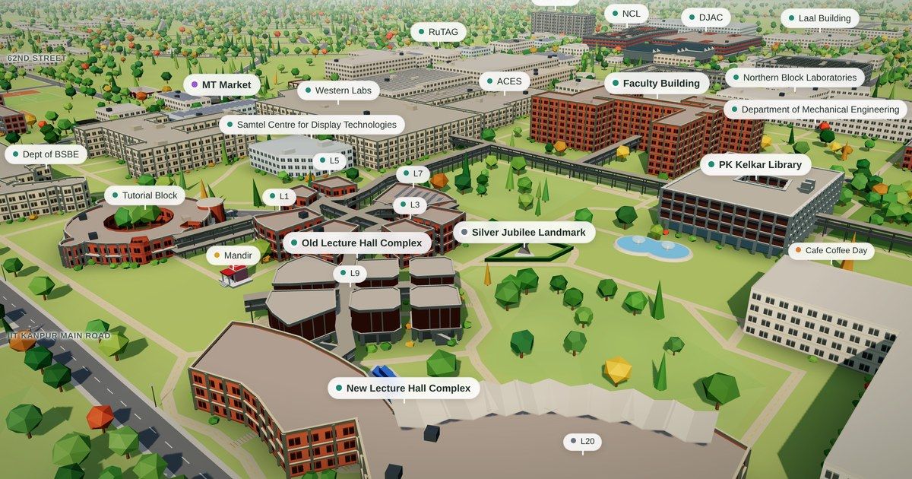

# IIT Kanpur in 3D

A hand-built 3D model of the IIT Kanpur campus that you can explore, search and find your way around, right in the browser.

**Live:** https://nisarg3176.github.io/iitk-3d-map/



Halls, lecture halls, the OAT, the main gate, cafés, shops and other landmarks are modelled from real photos and campus videos, with matching colours, signboards, entrances and even the street lamps at night.

## Features

- **Search anything**: halls and their blocks, departments, lecture halls, canteens, cafés, shops, roads and landmarks, by their real names or the short ones people use (CC, L20, CCD, MT, H12, ESB2…).
- **Find a professor's office**: type a professor's name to see their department, building and room on the map.
- **Directions from anywhere to anywhere**: pick a From and a To (or use your location) to get the walking route with distance and time.
- **Walk the route**: *Start* follows you live with GPS, turn by turn; *Preview* plays the walk so you can see it first.
- **Useful spots**: cycle repair, drinking water, toilets, ATMs and banks, photocopy, laundry, pharmacy, salons, post office, cycle parking, EV charging and lecture halls, each highlighted on the map with a list of the nearest ones.
- **Walk mode**: drop down to street level and stroll around campus.
- **Day and night**: the sun, shadows and seasons follow the real time in Kanpur; at night windows and street lamps light up.
- **2D map and angle lock**: switch to a flat map, or lock the tilt to zoom in easily.
- **Double-tap anywhere**: get that spot's name, coordinates and directions, and share it as a link.
- **Filters and sharing**: show only academic, hostels, food, shops, sports, health or worship, and share a link to any place or route.
- **Works on any phone**: a lighter mode switches on by itself on slower phones.

### Tips

- Tap any building or label for details.
- `/` or `Ctrl K` jumps to search, `Tab` on a result starts directions there, `Esc` closes panels.
- Try searching **water**, **atm**, **photocopy**, **cycle repair** or a professor's name.

## Run it locally

It's a static site with no build step. Serve the folder with any web server, for example:

```bash
python3 -m http.server 8000
```

then open http://localhost:8000. Opening `index.html` directly from disk won't work, because the browser blocks loading the code and JSON files that way.

## How the code is organised

No build step: the files are served as they are. `index.html` lists every code file (the `<link ... data-part>` lines),
and `js/main.js` downloads them all at once and runs them in that order as one program, so a function in any file can be
used from any other file.

| File | What it is |
| --- | --- |
| `index.html` | The page: panels, buttons and the list of code files |
| `css/style.css` | How the panels, labels and buttons look |
| `js/main.js` | Start-up: loads three.js, the data and the code files |
| `data/styles.json` | Building colours and which building gets which look (edit this to recolour a building) |
| `campus.json` | Campus map data: buildings, roads, paths, places and details |
| `people.json` | Professors and their offices |
| `preview.jpg` | Preview image for link sharing |

### Code files, in the order they run

| File | What it does |
| --- | --- |
| `js/core/helpers.js` | Shared helpers: random numbers, noise, geometry builder (Geo), polygon maths, ribbons, discs, dashes. |
| `js/core/scene.js` | Renderer, camera, lights, sky dome, stars and moon. |
| `js/core/textures.js` | Generated textures: window grids, glow sprites, ground detail. |
| `js/world/data.js` | Map data (campus.json) and fixes on load: renamed places, Hall 12/13 layouts, which buildings get which style (from data/styles.json). |
| `js/world/ground.js` | Ground overlays, seasonal grass/leaf tint, water shaders, ground plane and map areas (parks, pitches, parking, water…). |
| `js/world/roads.js` | Roads: asphalt, kerbs, footpaths, markings, rails; road-occupancy map used to keep things off roads. |
| `js/world/buildings.js` | Generic buildings from the map data: walls with window grids, flat/hip roofs, rooftop clutter, solar panels, bushes. Colours come from data/styles.json. |
| `js/world/places.js` | Places from the map data (points + named areas) and building categories for the filter chips. |
| `js/world/solar-cars.js` | Ground solar farm and parked cars. |
| `js/world/details.js` | Shared night-glow geometry, metro viaduct, raised walkways, bridges, steps, fences, canal, bleachers, point features (gates, towers, fountains, kiosks…). |
| `js/landmarks/_kit.js` | Helpers shared by every landmark file (opens the landmarks block, which _finish.js closes). Use: edges(outline) → wall edges with .at(t,o); bx(edge,t,o,w,d,y,h,col) box on a wall; band, cols, cl (paint a wall), pane (window glass, some lit at night), q3 (quad), txt / tex / plane / signOn (signboards), BN(/name/) finds a building. |
| `js/landmarks/facades.js` | Facade details for every styled building: concrete frames, floor bands, balcony stripes, awnings. |
| `js/landmarks/library.js` | P K Kelkar Library (glass ground floor, brick upper floors, crown), the Crow sculpture, and the library forecourt (fountain channels, planters, pergolas, terraces). |
| `js/landmarks/oat-sac.js` | Open Air Theatre (stage, bowl, stage house, wings), SAC tower, Students' Activity Centre and Indoor Sports Complex, OAT/SAC boundary wall, New SAC Road lanterns and gate board. |
| `js/landmarks/pronite.js` | Pronite ground: brick stage, fest bunting, light towers and entry arch. |
| `js/landmarks/shops-food.js` | Shops and food spots: Mama Mio, MT market stall, Starbucks & Subway, CC canteen, Cafe Coffee Day, Old Shopping Complex, ATM kiosk, Divyam Naturals. |
| `js/landmarks/services.js` | Health Centre, CMHW and the post office. |
| `js/landmarks/academic.js` | Academic buildings: IME domes, DJAC, Non Core Labs, Rajeev Motwani, CSE (KD), Tutorial Block, Wind Tunnel, Cessna at the Flight Lab, IITK Motorsports. |
| `js/landmarks/lecture-halls.js` | Old Lecture Hall Complex (L1–L15) and its sign, L20 (New Lecture Hall Complex) and the old stage on its lawn. |
| `js/landmarks/mandir.js` | LHC Mandir. |
| `js/landmarks/gates.js` | Main gate (walls, truss sign, guard hut), Kendriya Vidyalaya gate, Kargil Chowk. |
| `js/landmarks/halls.js` | Hostels: hall facades and name boards, Hall 12/13 entrances, hall corridors and cycle stands, night lights on the halls, Visitor Hostel. |
| `js/landmarks/sports.js` | Swimming pool, football and hockey ground fences and floodlights. |
| `js/landmarks/_finish.js` | Builds the window glass and the signboard atlas collected by all landmark files, then closes the landmarks block. |
| `js/world/power-entrances.js` | Power towers and wires, entrance doors on the nearest building wall, lane / point / house-number labels. |
| `js/world/trees.js` | Trees (avenue rows, clumps, map trees), shaped by the occupancy map; contact-shadow overlay. |
| `js/world/lamps.js` | Street lamps along every road (plus extra plaza lamps from xLamps) and their night glow. |
| `js/core/view.js` | Post-processing (bloom), map controls and the home view. |
| `js/ui/labels.js` | Floating name labels: placement, priorities, collision. |
| `js/core/time-sky.js` | Time of day, sun, sky colours, weather and seasons; night look (window glow, dimming bright walls). |
| `js/world/weather-fx.js` | Clouds and rain. |
| `js/world/life.js` | Life: traffic, cyclists, people, car lights, birds. |
| `js/ui/walk.js` | Walk mode (first person) and its joystick. |
| `js/ui/search.js` | Search box, results, focus marker, category chips. |
| `js/ui/sky-panel.js` | Time / weather / season panel, lock angle, 2D map. |
| `js/ui/directions.js` | Directions: road graph, closed roads, route finding, route line, from/to panel. |
| `js/ui/route-walk.js` | Walking a route: live GPS and preview. |
| `js/ui/cards.js` | Place cards, opening hours, tapping and double-tapping on the map (dropped pins). |
| `js/ui/spots.js` | Useful spots layers (toilets, water, ATMs…) and "nearest X" searches. |
| `js/ui/people.js` | Professors directory (people.json). |
| `js/ui/my-location.js` | My location (GPS). |
| `js/ui/links.js` | Shareable links (place, directions, pins). |
| `js/ui/about-keyboard.js` | Keyboard shortcuts and the About panel. |
| `js/core/loop.js` | Automatic lite mode, the render loop, start-up, and window.__api for testing. |

### Where to change what

- **A building's colour**: `data/styles.json` → `styles`. To give a building a different look, add its name under `byName`.
- **A hand-made landmark** (OAT, library, L20, mandir, pool, gates, halls…): the matching file in `js/landmarks/`.
  Every landmark file can use the helpers set up in `js/landmarks/_kit.js` (wall edges, boxes on walls, windows, signboards).
- **Night look, sky, weather, seasons**: `js/core/time-sky.js`. **Street lamps**: `js/world/lamps.js`.
- **Search, cards, directions, double-tap**: `js/ui/`.
- **A new file**: add a `<link rel="preload" ... data-part>` line for it in `index.html`, in the place where it should run.
- After changing a file, browsers may keep the old copy for up to 10 minutes. To make everyone get it at once, change the
  `?v=` number for that file in `index.html` too.

## Credits and sources

- Made by **Nisarg Parashar** and **Parul**, students at IITK.
- Building outlines, roads and footpaths start from © [OpenStreetMap contributors](https://www.openstreetmap.org/copyright), available under the Open Database License (ODbL), then corrected and detailed by hand.
- Professors' offices come from IIT Kanpur's public [faculty directory](https://www.iitk.ac.in/iitk-faculty).
- 3D rendering with [three.js](https://threejs.org).

This is a student project and isn't an official IIT Kanpur map.

## Something off?

Spotted a building in the wrong place, a missing shop or a wrong colour? Open an issue on this repo and it'll be fixed in the next update.
